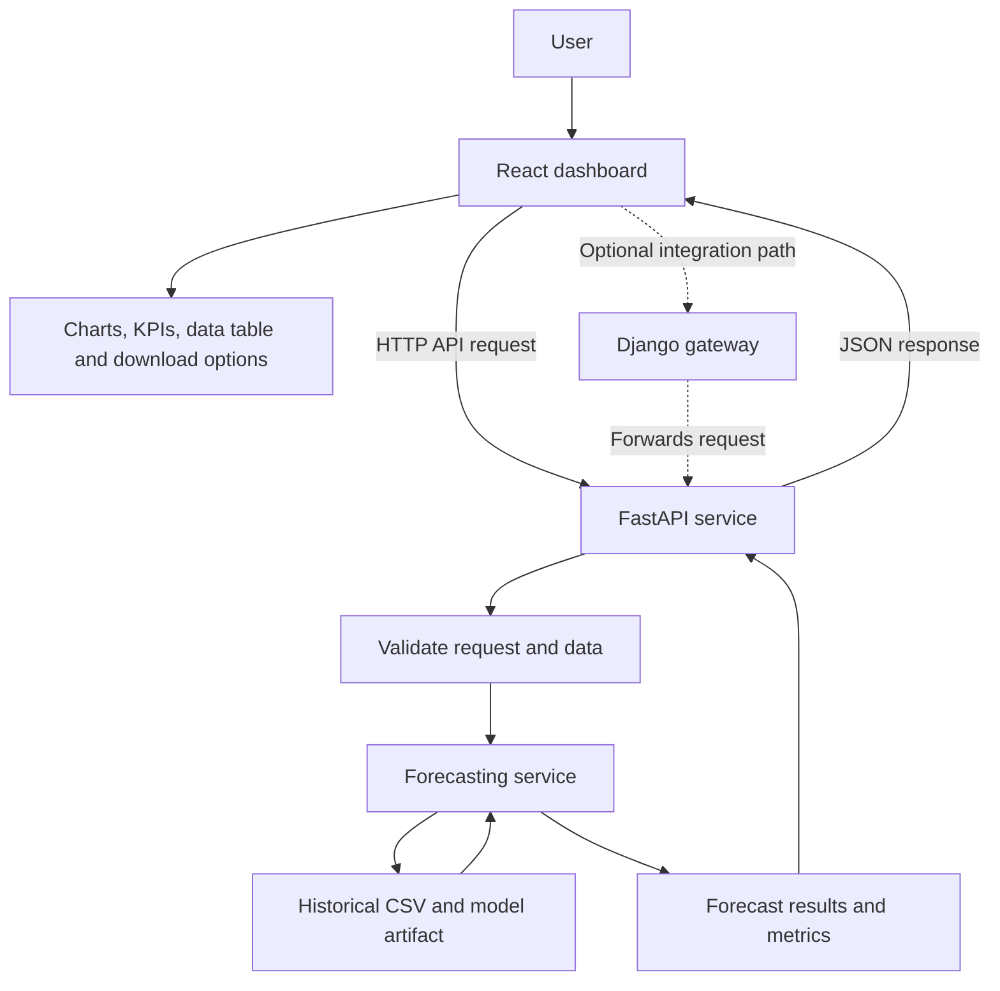
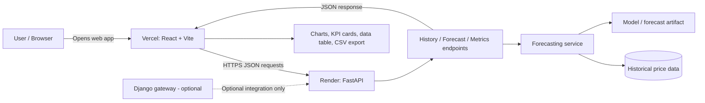
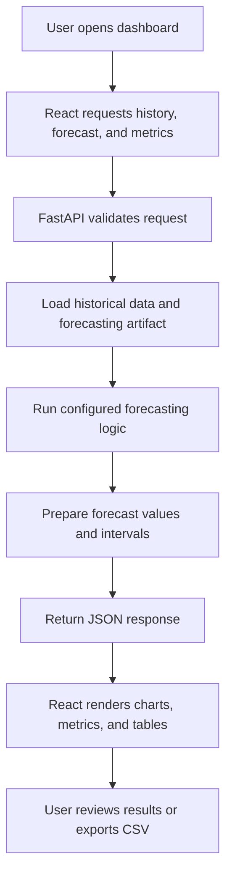
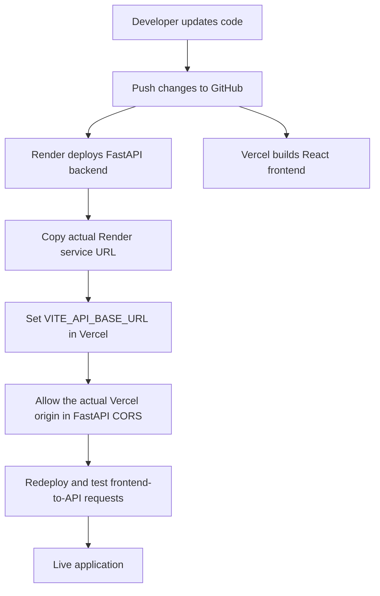

# Way2Agribusiness — 12-Month Price Forecasting Platform

A web application for exploring historical monthly prices and viewing a 12-month price forecast. The project combines a React dashboard with a FastAPI forecasting API. An optional Django gateway is included to demonstrate a possible application-level integration layer.

## Live Demo

- **React web application (Vercel):** https://price-forecasting-platform-git-main-dhana-0-1-projects.vercel.app
- **FastAPI backend (Render):** https://price-forecasting-platform.onrender.com
- **Django backend (Render):** https://price-forecasting-django.onrender.com
- **FastAPI interactive API docs:** https://price-forecasting-platform.onrender.com/docs
- **GitHub repository:** https://github.com/DhanaSekhar-0-1/price-forecasting-platform

> These are placeholders, not live URLs. After deployment, replace them with the actual URLs shown by Vercel, Render, and GitHub. Do not invent a Vercel URL in advance: Vercel assigns the deployment URL when the project is deployed.

## Project Goal

Build a practical web interface for a monthly-price forecasting workflow. The application is intended to help users:

- inspect the historical price observations available to the forecasting service;
- view the next 12 months of forecast results and uncertainty intervals when available;
- review model evaluation information;
- validate incoming historical data before using it for forecasting; and
- understand how the forecasting API could be deployed and integrated into a larger application.

The original internship assignment also asks for discussion of data cleaning, model selection, evaluation, business actions, action effectiveness, Django deployment, frontend/API integration, and production monitoring.


## Notebook Guide

**Notebook:** `notebooks/Way2Agribusiness_12_Month_Price_Forecasting.ipynb`

Open this notebook in Jupyter Notebook, JupyterLab, or VS Code. Run the cells from top to bottom in order because later sections may depend on variables, dataframes, and model results created earlier.

Use the notebook's existing Markdown headings as the authoritative section navigation. The workflow should be easy to follow in this order:

1. **Problem statement and objective** — define the monthly price forecasting task and forecast horizon.
2. **Imports and configuration** — load Python packages and set file paths.
3. **Load and inspect data** — read the dataset and review columns, date range, and data types.
4. **Data quality checks** — examine missing values, invalid dates/prices, duplicates, chronological order, and potential anomalies.
5. **Exploratory analysis** — visualize the historical price series and relevant patterns.
6. **Time-series preparation** — sort observations by date and prepare chronological train/validation/test periods.
7. **Baseline and candidate models** — compare the methods that are actually implemented in the notebook.
8. **Model evaluation** — report the notebook's actual MAE, RMSE, MAPE/WAPE or other computed metrics; do not invent values.
9. **12-month forecast and uncertainty** — inspect the generated forecast, intervals, and the last observed date.
10. **Business interpretation** — explain how the forecast could inform purchasing, inventory, supplier contracts, and price reviews.
11. **Monitoring and retraining** — describe how future actual prices, forecast errors, and drift would be reviewed.
12. **Conclusions and limitations** — summarize findings and disclose small test-set limitations and data freshness.

> This is a reader's navigation guide, not a guarantee that the notebook contains every heading listed above. Keep the numbered labels aligned with the actual Markdown headings in the notebook before publishing.

### Key files

| File | Purpose |
|---|---|
| `notebooks/Way2Agribusiness_12_Month_Price_Forecasting.ipynb` | Exploratory analysis, model evaluation, forecast workflow, and assignment answers |
| `data/price_data.csv` or the actual dataset path in the repository | Historical monthly observations |
| `artifacts/price_model_artifact.joblib` or the actual artifact path | Saved model/forecast metadata used by the backend |
| `outputs/price_forecast_next_12_months.csv` or the actual output path | Generated forecast output, if included |
| `frontend/` | React + Vite user interface |
| `backend/` | FastAPI application and forecasting endpoints |
| `django_gateway/` | Optional Django integration example |

Use the actual repository paths in the table. If your files are currently stored elsewhere, update the paths rather than moving files blindly.

## Technology Stack

| Component | Technology | Responsibility |
|---|---|---|
| Frontend | React, Vite | Dashboard, charts, tables and user interaction |
| Forecast API | FastAPI, Python | API endpoints, request validation and forecasting-service integration |
| Forecasting | Python, pandas, NumPy, scikit-learn/joblib as applicable to the supplied workflow | Data handling, model/forecast logic and evaluation |
| Optional integration layer | Django | Example gateway/application layer; not required to run the primary dashboard |
| Frontend hosting | Vercel | Hosting the React application |
| Backend hosting | Render | Hosting the FastAPI service |

## Application Flowchart



### Request flow

1. A user opens the React web application.
2. React calls the FastAPI API using the configured API base URL.
3. FastAPI validates the request and invokes the forecasting service.
4. The service reads the configured historical data and model/forecast artifacts.
5. FastAPI returns results as JSON.
6. React renders the response in the dashboard.

Django is optional. The primary frontend flow is React → FastAPI; the frontend does not use Django unless it is explicitly configured to route requests through it.

## Architecture Diagrams

These diagrams describe the intended React + FastAPI deployment. Django is optional and is not in the primary request path unless you explicitly configure React to use it.

### 1. System architecture



### 2. Forecast request workflow



### 3. GitHub-to-hosting deployment workflow



> **Deployment reminder:** Replace placeholder URLs with the real URLs assigned by GitHub, Render, and Vercel after deployment. Ensure the Render backend's CORS configuration allows the exact deployed Vercel origin.

## Forecasting Process

1. **Load data:** Read the supplied CSV containing `date` and `avg_monthly_price`.
2. **Validate data:** Check expected columns, date parsing, numeric values, missing values and chronological order.
3. **Review model/artifact:** Inspect the supplied `price_model_artifact.joblib` and the forecasting notebook before using the artifact.
4. **Generate forecast:** Use the forecasting logic exposed by the backend. Confirm the forecast horizon and data cutoff before interpreting results.
5. **Return uncertainty information:** Show prediction intervals only when they are provided or correctly computed by the forecasting implementation.
6. **Present results:** Render forecast values, historical observations and available evaluation metrics in the React UI.
7. **Monitor and update:** For production use, refresh historical data, evaluate predictions against subsequently observed prices, and retrain or revise the model when evidence supports doing so.

## Results and Interpretation

The supplied project files include:

- `Way2Agribusiness_12_Month_Price_Forecasting.ipynb` — the original forecasting workflow and assignment analysis;
- `price_data.csv` — historical observations;
- `price_forecast_next_12_months.csv` — an existing 12-month forecast with 80% and 95% intervals;
- `price_model_artifact.joblib` — model metadata and related forecasting information.

**Important freshness note:** The supplied forecast file covers October 2025 through September 2026. As that period has passed, it must not be presented as the current next-12-month forecast. Refresh the historical dataset and regenerate the forecast before using the dashboard for current planning.

**Model limitation:** The supplied artifact identifies the selected approach as a naive baseline and contains metadata/history rather than a conventional fitted estimator that can automatically be assumed to support `.predict()`. Verify the notebook's model-selection and evaluation results before making claims about model superiority or production accuracy.

### How to report performance

Use the evaluation values actually calculated by the notebook or backend. Suitable measures for a time-series regression task may include:

- **MAE:** average absolute prediction error, in the price unit;
- **RMSE:** penalizes larger errors more heavily;
- **WAPE:** total absolute error divided by total actual value, where this is appropriate and the denominator is non-zero.

Evaluate with chronological holdout or rolling-origin validation. Do not randomly shuffle time-series observations. Do not invent metric values or describe a forecast as accurate without supporting validation results.

## What This Project Achieves

- Establishes a React-based interface for the price-forecasting workflow.
- Exposes forecasting functionality through a FastAPI service.
- Separates the frontend from the prediction API, allowing independent deployment.
- Provides an API structure that can be deployed on Render and a frontend that can be hosted on Vercel.
- Preserves the original notebook, data and artifact for review.
- Documents an optional Django integration approach without requiring Django to run the primary UI.
- Provides a starting point for data validation, forecast display, automated API testing and future monitoring.

The items above describe the intended project capabilities. Confirm each feature in the deployed application before presenting it as production-ready.

## Run Locally on Windows

Prerequisites: Python 3.12 (or a compatible Python version supported by the dependencies), Node.js/npm, and Git.

### 1. Start FastAPI

Run these commands from the project root:

```powershell
py -3.12 -m venv .venv
.venv\Scripts\Activate
python -m pip install --upgrade pip
pip install -r backend\requirements.txt
uvicorn backend.app.main:app --reload --port 8000
```

API documentation: `http://127.0.0.1:8000/docs`

### 2. Start React

Open a second terminal:

```powershell
cd frontend
npm install
npm run dev
```

Open the local URL printed by Vite, commonly `http://localhost:5173`.

Configure the frontend API base URL using the environment variable expected by the project's API client. For Vite, client-side environment variables normally begin with `VITE_`. Use the exact variable name read by the source code.

### 3. Optional Django gateway

Django is not required to run the React + FastAPI application. If you want to test the optional gateway, open a separate terminal at the project root and follow the dependencies and instructions in `django_gateway/`.

## Deployment

### FastAPI on Render

- Create a Render Web Service connected to this GitHub repository.
- Set the build command to `pip install -r backend/requirements.txt`.
- Set the start command to `uvicorn backend.app.main:app --host 0.0.0.0 --port $PORT`.
- Verify the deployed `/health` endpoint and `/docs`.
- Configure CORS to allow the exact Vercel frontend origin.

### React on Vercel

- Import the repository into Vercel.
- Set the project root directory to `frontend`.
- Build command: `npm run build`.
- Output directory: `dist`.
- In Vercel Project Settings → Environment Variables, set `VITE_API_BASE_URL` to the deployed Render service base URL, for example `https://your-api-service.onrender.com` (use your actual Render URL, without `/docs` and without a trailing slash).
- The primary production path is Vercel → FastAPI. Do not set this variable to the optional Django gateway.
- FastAPI allows the stable project alias `https://price-forecasting-platform.vercel.app` and narrowly scoped preview hosts for this Vercel project. If Vercel assigns a different project alias, add that exact origin to `CORS_ALLOWED_ORIGINS` on Render as a comma-separated value.
- Redeploy after changing environment variables.

## Django's Role

Django is optional in the current primary deployment architecture. It can be extended to manage user accounts, permissions, administrative workflows, approval processes and audit records. If used as a gateway, React must be configured to call Django, and Django must forward appropriate requests to FastAPI. These capabilities should only be claimed as implemented after they are built and tested.

## Testing Checklist

- [ ] Backend automated tests pass with `pytest -q`.
- [ ] FastAPI `/health` responds successfully.
- [ ] Forecast endpoint returns valid JSON and handles invalid inputs.
- [ ] Historical data endpoint returns the expected records.
- [ ] React production build succeeds with `npm run build`.
- [ ] React can reach the deployed API without CORS errors.
- [ ] Data Overview loads and shows records/date range.
- [ ] Forecast dates are future dates relative to the latest available observation.
- [ ] Evaluation metrics are from chronological validation.
- [ ] Deployed URLs above are replaced with tested, real URLs.

## Assignment Context

The internship task asks candidates to forecast average monthly prices for the next 12 months and address data cleaning, model choice, evaluation, business response, measuring effectiveness, Django deployment, Django/FastAPI integration, frontend integration, and production monitoring. Keep the Jupyter Notebook and updated resume as separate submission deliverables if required by the employer.
